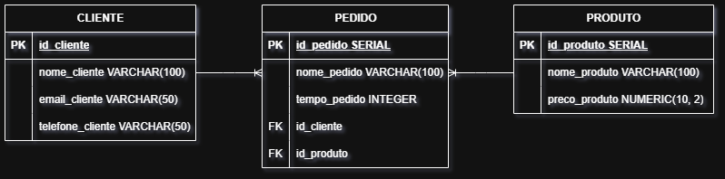

O projeto consiste no desenvolvimento do Produto Mínimo Viável (MVP) para uma plataforma de e-commerce voltada ao público geek/otaku. O sistema busca unir um gerenciamento de estoque eficiente com estratégias visuais e psicológicas de vendas para alavancar a conversão.

Trata-se de uma loja / e-commerce especializada em colecionáveis, action figures e produtos relacionados a animes e franquias geek. O tom de voz do cliente é jovem, informal e utiliza bastante o "jargão corporativo/tech" mesclado com gírias de internet e cultura pop.

**CLIENTE:** 1 cliente para N pedidos (1:N).\
**PEDIDO:** N pedidos para 1 produto (1:N).
